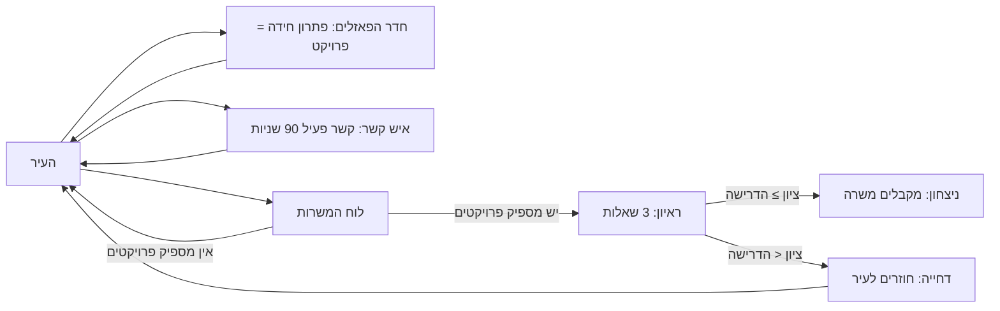

# Level Design: הראיון הבא (The Next Interview)

## 1. רקע מהמחקר ומקהל היעד

- **קהל ראשי:** מחפשי עבודה צעירים (בוגרי תואר חדשים ואנשים שעוברים תחום), שרוצים להתאמן לפני ראיון אמיתי.
- **מה מניע אותם:** תרגול בלי לחץ, הבנה של מה מצפים מהם, ותחושת התקדמות.
- **מתחרים:** Thank You For Your Application, S.T.A.R, Job Interview Simulator, InterviewPal.
- **הבדל שהשלבים צריכים להציג:** השחקן מתכונן לראיון דרך משחק. הוא פותר חידות שהופכות לפרויקטים, יוצר קשרים עם אנשים, ואז כותב תשובות חופשיות בראיון שמוערך.

**מה מזה נובע לתכנון השלבים:** כל שלב קצר (עד 5 דקות), המטרה ברורה, והתקדמות נראית לעין (מספר הפרויקטים והקשרים).

---

## 2. סקירת השלבים

| שלב | סוג | מה השחקן לומד | המשרה | דרישה | ציון נדרש |
|---|---|---|---|---|---|
| 0 | הדרכה (Tutorial) | תזוזה, אינטראקציה, חידה, איש קשר, לוח משרות | Junior Developer | פרויקט אחד | 60 |
| 1 | קל | לבנות פרויקטים ולתרגל ראיון ראשון | Junior Developer | פרויקט אחד | 60 |
| 2 | בינוני | לנהל זמן, לשלב חידות קשות וקשרים | Senior Game Developer | 4 פרויקטים | 80 |
| 3 | קשה | לתכנן מסלול שלם תחת לחץ זמן | Lead Designer | 6 פרויקטים | 90 |

**הערה:** בשלבים 2 ו-3, כל קשר פעיל נותן בונוס של 5 נקודות בציון הסופי, עד 15 נקודות (3 קשרים). קשר נשאר פעיל 90 שניות.

---

## 3. פירוט כל שלב

### שלב 0: הדרכה (Tutorial)
- **מטרה:** השחקן מבין את הלולאה: לעבור בעיר, לפתור חידה, לדבר עם אדם, ולהגיש מועמדות.
- **מה קורה:**
  1. השחקן נכנס לעיר ורואה רמז "Interact" כשהוא מתקרב לדמות.
  2. הוא פותר חידה אחת בחדר הפאזלים (דרגה 1: חיבור שברים עם מכנה זהה).
  3. הוא מדבר עם איש קשר אחד.
  4. הוא ניגש ללוח המשרות ומגיש מועמדות ל-Junior Developer.
  5. בראיון, הוא עונה על שלוש שאלות.
- **תנאי ניצחון:** השחקן מקבל משרה.
- **כישלון:** לא נדרש. אם הציון נמוך, השחקן חוזר לעיר עם הודעת משוב.

### שלב 1: קל (Junior Developer)
- **דרישה:** פרויקט אחד (חידה אחת שנפתרה).
- **ציון נדרש:** 60 מתוך 100.
- **זמן:** 5 דקות.
- **השחקן צריך:** לפתור חידה נוספת, לדבר עם איש קשר אחד, ולהגיש בזמן.

### שלב 2: בינוני (Senior Game Developer)
- **דרישה:** 4 פרויקטים.
- **ציון נדרש:** 80.
- **זמן:** 5 דקות.
- **שיקול:** השחקן צריך לשלב חידות דרגה 1, 2 ו-3, כי כל חידה נותנת נקודות לפי הדרגה שלה. למשל: חידה 3 + חידה 1 = 4 נקודות.
- **קשרים:** מומלץ לדבר עם שניים או שלושה אנשים לפני הראיון, כדי לקבל בונוס.

### שלב 3: קשה (Lead Designer)
- **דרישה:** 6 פרויקטים.
- **ציון נדרש:** 90.
- **זמן:** 5 דקות.
- **שיקול:** מסלול אפשרי: שתי חידות דרגה 3 + חידה דרגה 2 = 8 נקודות. או: 6 חידות דרגה 1 (יותר זמן).
- **קשרים:** שלושה קשרים מביאים בונוס מקסימלי של 15, שחשוב במיוחד כאן.

---

## 4. דיאגרמה: לולאת המשחק



---

## 5. דיאגרמה: מפת השלב בעיר

```
+------------------------------+-----------------+
|                              |                 |
|  [Job board]                 |  Puzzle room    |
|                              |     [ ] [ ]     |
|        @ (player)            |                 |
|                  (c) (c)     |      [ ]        |
|                              |                 |
+----------------- door ------+-----------------+

@  = השחקן             (c) = איש קשר (נוצר לבד)
[ ] = חידה (נוצרת לבד)   [Job board] = לוח המשרות
```

---

## 6. מה כבר ממומש ומה עוד מתוכנן

- **ממומש היום:** עיר אחת, חדר פאזלים, אנשי קשר, לוח משרות עם שלוש משרות (שלבים 1–3 כמשרות), ראיון עם שלוש שאלות, ושליטה במקלדת ובמובייל.
- **מתוכנן:** הפרדת הדרכה (שלב 0) לסצנה נפרדת עם הנחיות על המסך, ושאלות ראיון שונות לכל משרה.

---

## 7. בדיקה מול משתמשים

- לבדוק את הגרסה עם 3 מחפשי עבודה, ולמדוד: האם הם מבינים את הלולאה בלי הסבר נוסף? האם 5 דקות מספיקות לשלב הקשה?
- לתקן לפי התוצאות, למשל: אם השחקנים לא מוצאים את חדר הפאזלים, להוסיף רמז על הדלת.
